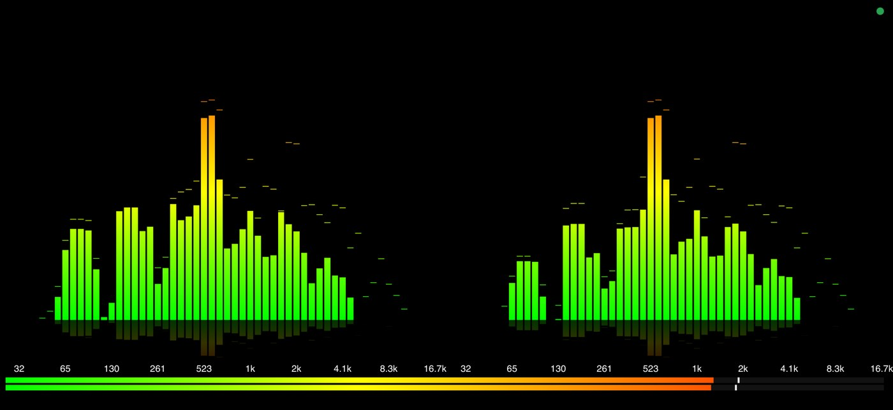
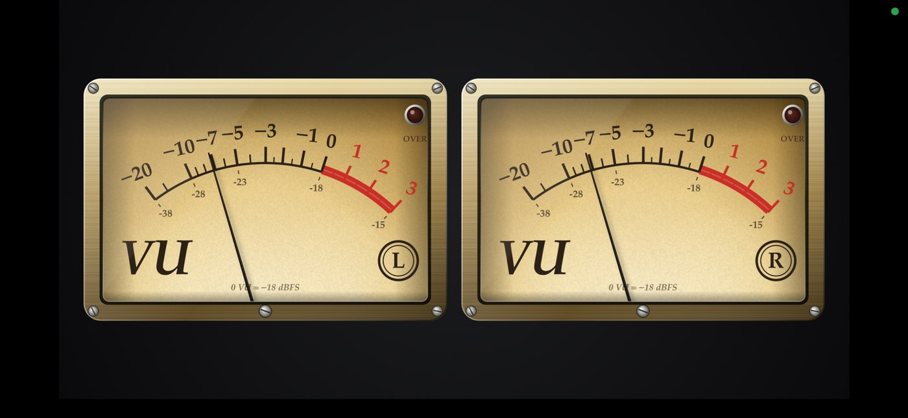
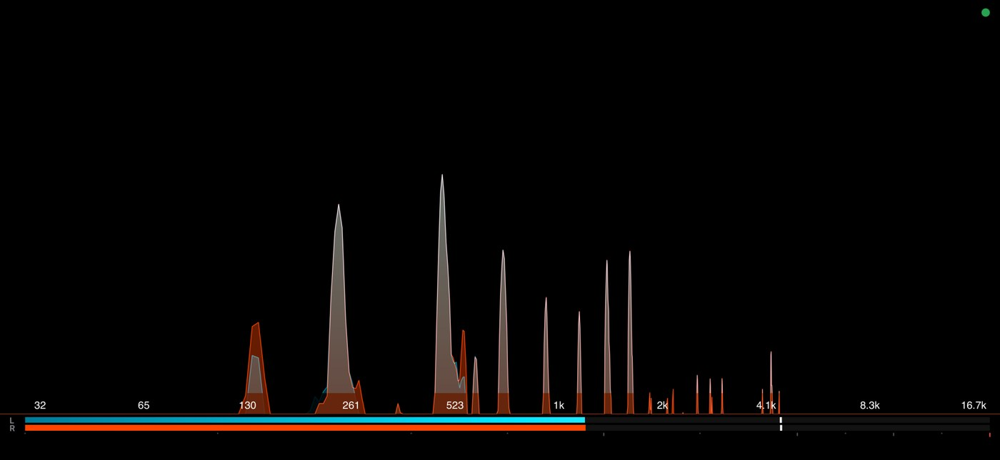
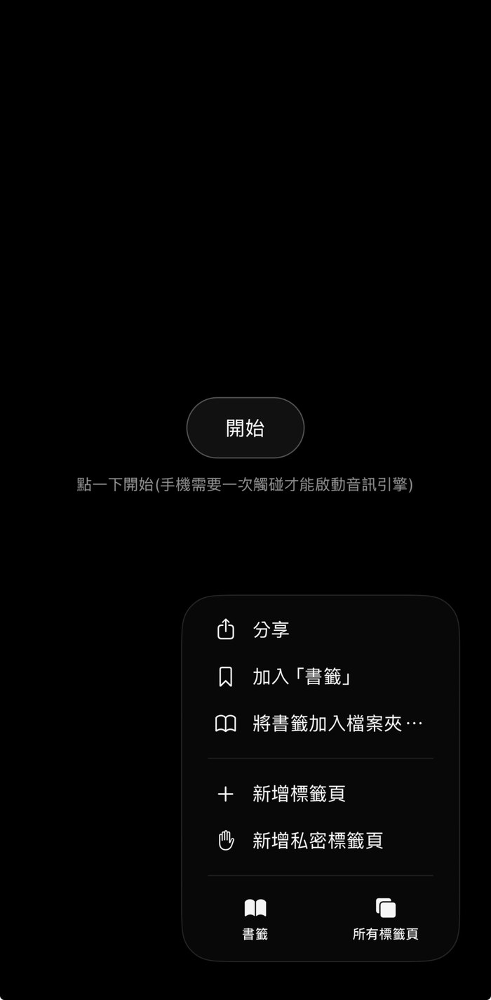
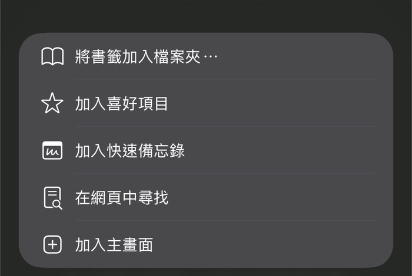
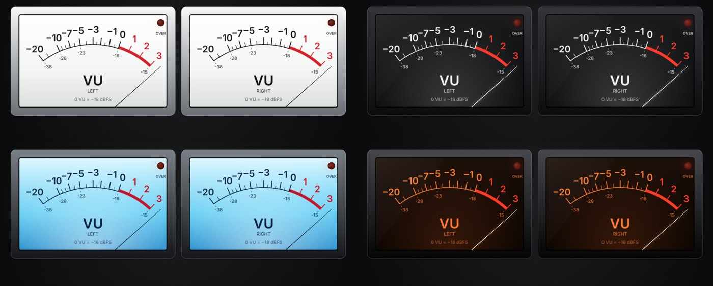

# AudioMotion_TW — LAN Spectrum & VU Streamer

[繁體中文](README.md) · **English**

Stream whatever your PC is playing (Tidal / YouTube / local player) over Wi-Fi and watch it on your phone as a
hi-fi style LED spectrum analyzer ([audioMotion-analyzer](https://github.com/hvianna/audioMotion-analyzer)) or as a
pair of analog VU meters.


<table>
  <tr>
    <td width="50%"></td>
    <td width="50%"></td>
  </tr>
  <tr><td align="center">Spectrum (L/R channels)</td><td align="center">Analog VU meters</td></tr>
</table>

<details>
<summary>More screenshots</summary>

| L/R blend overlay | LED spectrum + vertical meter |
|---|---|
|  |  |

</details>

## Architecture
```
PC:    player → default speakers (plays as usual)
              └─ WASAPI loopback (read-only tap) → server.py ─ WebSocket (PCM 16-bit) ─┐
Phone: browser ← Web Audio (muted output) → audioMotion analysis/rendering ←───────────┘
```
- **No sound-card changes**: loopback is a read-only tap. No default-device switching, no "Stereo Mix", no virtual
  audio driver, no volume/enhancement changes.
- **Low power**: nothing is captured while no phone is connected; the phone disconnects and stops drawing when the
  page goes to the background or the screen locks.
- About 1.5 Mbps (48 kHz, 16-bit, stereo). The FFT runs on the phone; the PC does almost no computation.

## Quick start

### 1. On the PC (Windows)
1. Install Python 3.9+ (tick **Add to PATH**).
2. Download or clone this repo to any folder: `git clone https://github.com/YCL-Jeff/AudioMotion_TW.git`
3. Double-click `start.bat`. On first run it installs `PyAudioWPatch` (the only dependency; the server itself uses the
   standard library only).
4. The console prints the address(es), e.g. `http://192.168.1.23:8765/`. Keep the window open.
5. If Windows Firewall asks, allow **Private networks**.
6. Play music as usual (Tidal / YouTube / any player). Nothing about your sound card or default device changes.

> Tip: `python server.py --fake` plays a synthetic test tone so you can check the phone setup without music.

### 2. On the phone
1. Connect the phone to the **same Wi-Fi / LAN** as the PC (not mobile data; guest networks with "client isolation" block it).
2. Open the printed address in the browser (Safari / Chrome), e.g. `http://192.168.1.23:8765/`, and tap **Start**
   (a tap is required once so the browser may start its audio engine).
3. Tap the screen to open the settings panel (the ⚙ icon appears and fades after 5 s). Pick a preset category, then a preset.
4. Rotate to landscape for the best view.

<p align="center"></p>

#### Make it feel like an app (recommended)
**iPhone / iPad (Safari)**: open the page → tap the share / `…` menu → **Add to Home Screen** (加入主畫面). Launching
from the new icon opens it full screen without the address bar.

<p align="center"></p>

**Android (Chrome)**: `⋮` menu → **Add to Home screen** / **Install app**. The panel's **Fullscreen** button also works.

#### Keep the screen on
Browsers do not allow Wake Lock on plain `http://` pages, so set it manually:
- **iPhone**: Settings → Display & Brightness → **Auto-Lock → Never**; turn off Portrait Orientation Lock.
- **Android**: Settings → Display → **Screen timeout** → longest; turn on Auto-rotate.
Remember to restore the setting afterwards. A dim / OLED-black screen uses very little power.

#### Tips
- The phone's own speaker is **muted** by this page; the music keeps playing on the PC's speakers as usual.
- Give the PC a fixed IP (router DHCP reservation) and bookmark / add the page to the Home Screen once.
- When the phone screen locks or the page goes to the background it disconnects and the PC stops capturing; open the page again to resume.

### Troubleshooting
| Symptom | Fix |
|---|---|
| Phone cannot open the page | Same Wi-Fi? Firewall allowed for Private networks? Try the other printed address; disable router "AP / client isolation". |
| Port 8765 busy | The server auto-tries the next ports (up to +19); use the address it prints, or pass `--port`. |
| Connected but spectrum is flat | Silence sends no data. If your player outputs to a non-default device, run `python server.py --list` then `--device KEYWORD`. |
| Stutter / lag | Raise `LATENCY` in `web/index.html`; use 5 GHz Wi-Fi; lower FPS in Power tab. |
| Page freezes after leaving and returning | iOS often leaves the audio engine in a fake "running" state after backgrounding. After being away for more than 1.5 s the page now reloads itself and reattaches to the stream; just tap once when "Tap the screen to continue" appears. |
| Saved presets not on the phone | Restart `start.bat` so the new server (with preset sync) is running. |

### Command line
```
python server.py --list             list loopback devices
python server.py --device KEYWORD   pick a device (default = system default output)
python server.py --port 9000
python server.py --fake             synthetic test audio (no real capture)
```

## Settings panel
- Tap anywhere or the ⚙ icon (it fades out after 5 s). Portrait = bottom drawer, landscape = side panel, so the
  spectrum stays visible while you tune.
- Tabs: Presets / Channel layout / Look / Meter / Peaks & scale / Analysis / Power. Irrelevant options hide
  automatically; double-tap a slider to reset it.
- **Channel layouts**: combined, L/R blend overlay (mixed colors), L/R native overlay, side by side, top/bottom.
  The blend overlay runs two analyzers (one per channel) composited with CSS blend modes (screen / lighten / add /
  difference), so both channels stay distinguishable even in LED mode.

## Presets
- The top of the **Presets** tab has category buttons (Spectrum / LED / L-R / VU meter / Eco; opens on Spectrum). Tap a category, then a
  preset. Large touch targets, one-handed friendly. The default on first launch is the smooth spectrum. The LED category has four clearly different looks (classic green-yellow-red, Hi-Fi amber, ice-blue fine grid, rainbow octave), all with **true LEDs** (whole segments lit).
- **The level meter is a global setting.** Applying a preset never changes the bottom meter's style, position or
  size, so nothing jumps when you switch. Only presets in the *VU meter* category set the meter style
  (bottom VU / bar) or enter fullscreen VU. Custom presets do not store meter settings either.
- **Custom presets**: name and save the current settings (same name overwrites); overwrite / rename / delete. They
  are stored in the phone browser and synced to `presets.json` next to `server.py`, so they survive switching phones
  or clearing browser data. (Restart `start.bat` after updating the server so sync works.)

## Fullscreen VU mode
Choose "Fullscreen analog VU" under Meter → Display (or use the **Spectrum ⇄ VU** button in the panel header): the whole
screen shows two rectangular (3:2) VU meters, side by side in landscape and stacked in portrait, scaled as large as
possible. Spectrum analysis is paused to save power. Adjustable: face color, backlight, Headroom, bezel finish,
needle speed, meter size.

## Level meters
Left and right channels, placed at the bottom / right / left (right is recommended for landscape phones; the panel
then moves to the left side). Two styles:

**Bar (default)**: dBFS peak, graphics only, no numbers. Thin, continuous, and the color follows the main spectrum
gradient by default (or by level green-yellow-red, or any gradient). Optional LED segments, RMS and tick marks;
as thin as 8 px; adjustable floor, peak hold and fall speed.

**Analog VU needle meters**: two rectangular meters in an original retro hi-fi amplifier design (brushed bezel,
paper grain, backlight glow, screws), standard VU scale (-20…+3, amplitude scale, 0 VU at about 71 %, red zone 0…+3).
The needle is a second-order system: about 300 ms to settle with slight overshoot.
- Size (60–260 px), face color (warm cream / amber / cool white / night blue), backlight, needle speed.
- **Headroom 4–26 dB** (default 18): 0 VU = -N dBFS. Lower numbers push the needle into the red sooner.
- **Scale mode**: VU scale or dBFS scale (converted from Headroom); the inner small numbers always show dBFS.
- **Overload LED** (top right): lights at peaks ≥ -0.009 dBFS, holds 1 s, then fades over 3 s.
- Sizing: fullscreen uses "meter share of screen"; otherwise "meter height".
- "Overlay on spectrum" keeps the spectrum full size, useful for short landscape screens.
- Everything is drawn in code at runtime: no image files, no brand marks.

### Calibration standard (Headroom)
"Calibration standard" under Meter sets which dBFS level equals 0 VU:

| Digital level (dBFS) | Maps to | Typical use |
|---|---|---|
| -18 dBFS (common) | 0 VU | Professional music production, mixing, studios |
| -20 dBFS | 0 VU | Film, TV broadcast, AV engineering |
| -14 dBFS | 0 VU | Modern loud pop, some consumer audio gear |
| 0 dBFS | Needle pinned (beyond +14 to +20 VU) | Absolute digital limit; clipping and distortion beyond it; overload LED lights |

The menu offers these three standards; "Headroom fine-tune" accepts any value from 4 to 26 dB.

### VU face styles
<p align="center"></p>

Under Meter → Face color: **warm cream**, **amber**, **night blue** (vintage amplifier look: brushed bezel, paper grain, screws) and the flat modern **white face / black & red text**, **black face / white & red text**, **ice-blue backlit**, **orange on black** (matte bezel, thin needle, no screws). Bezels: champagne brass / gunmetal / silver / black / matte grey; a **wide (2:1)** option is available too. The *Fullscreen VU* and *Bottom VU* preset categories offer one-tap combinations.

## Notes
- Phones must use `http://<LAN IP>`; Wake Lock is unavailable on insecure origins, so raise the phone's screen
  timeout or use fullscreen.
- Latency is about 100 ms. Tune `LATENCY` in `web/index.html` (raise it if your Wi-Fi jitters).
- WASAPI loopback sends nothing during silence, so the spectrum falling to zero is normal.
- Windows only for capture (WASAPI loopback via PyAudioWPatch). The viewer runs in any modern phone browser.

## Security & privacy
- The server has **no authentication** and binds to `0.0.0.0`: any device on the same LAN that knows the address can watch
  the spectrum of what you are playing (no file names or metadata, but it is still eavesdropping on loudness/rhythm).
  **Use it on a trusted home LAN only and never port-forward it to the internet.**
- To restrict access, start with `--host 127.0.0.1` or your specific LAN IP.
- The phone only receives audio data; nothing is uploaded to the internet. No tracking, analytics or external requests at runtime.
- `/api/presets` accepts JSON ≤ 256 KB and writes `presets.json`; another LAN user could overwrite your presets (same trust boundary).
- The static file server guards against path traversal and only serves files under `web/`.
- `.gitignore` excludes `presets.json`. Before publishing, check that your commit author e-mail is one you are happy to make public (`git config user.email`).

## License
AGPL-3.0, see `LICENSE`. The bundled [audioMotion-analyzer](https://github.com/hvianna/audioMotion-analyzer)
(AGPL-3.0, © Henrique Avila Vianna) lives in `web/vendor/` with its license file; the VU meter technique was
informed by [vu-meter-react](https://github.com/Jun-Murakami/vu-meter-react) (MIT) but no code was copied.
