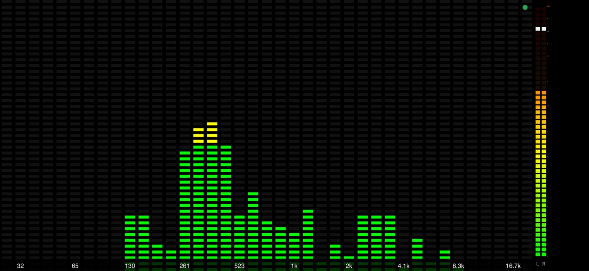

# AudioMotion_TW — 區網頻譜與 VU 串流

**繁體中文** · [English](README.en.md)

電腦播放的任何聲音(Tidal / YouTube / 本機播放器)→ 擷取 → Wi-Fi → 手機瀏覽器用
[audioMotion-analyzer](https://github.com/hvianna/audioMotion-analyzer) 顯示 LED 頻譜。


<table>
  <tr>
    <td width="50%"></td>
    <td width="50%"></td>
  </tr>
  <tr><td align="center">LED / 頻譜(左右聲道)</td><td align="center">類比 VU 錶頭</td></tr>
</table>

<details>
<summary>更多截圖</summary>

| 左右疊圖(混色) | LED 頻譜 + 右側直式電平表 |
|---|---|
|  |  |

</details>

## 架構
```
電腦: 播放器 → 預設喇叭(照常出聲)
              └─ WASAPI loopback(唯讀旁聽) → server.py ─ WebSocket(PCM 16-bit) ─┐
手機: 瀏覽器 ← Web Audio(靜音輸出)→ audioMotion 分析/繪圖 ←──────────────────────┘
```
- **不改動音效卡**:loopback 只是唯讀旁聽,不切換預設裝置、不開「立體聲混音」、不裝虛擬音效卡、不動音量/增強。
- **省電**:沒有手機連線時完全不擷取;手機切到背景/鎖屏會自動斷線並停止繪圖。
- 頻寬約 1.5 Mbps(48 kHz、16-bit、立體聲);手機端 FFT 由手機算,電腦端幾乎零運算。

## 快速開始

### 一、電腦端(Windows)
1. 安裝 Python 3.9+(安裝時勾選 **Add to PATH**)。
2. 下載或 clone 本專案到任意資料夾:`git clone https://github.com/YCL-Jeff/AudioMotion_TW.git`
3. 雙擊 `start.bat`。首次會自動安裝 `PyAudioWPatch`(唯一的套件,伺服器本身只用標準函式庫)。
4. 視窗會印出網址,例如 `http://192.168.1.23:8765/`,請保持視窗開著。
5. Windows 防火牆若詢問,請對「**私人網路**」允許。
6. 照常播放音樂(Tidal / YouTube / 任何播放器)。不會更動音效卡或預設裝置。

> 小技巧:`python server.py --fake` 會送出合成測試音,沒有音樂也能先測手機設定。

### 二、手機端
1. 手機連上**與電腦相同的 Wi-Fi / 區網**(不是行動數據;訪客網路若開了「用戶端隔離」會連不上)。
2. 用瀏覽器(Safari / Chrome)開啟視窗印出的網址,例如 `http://192.168.1.23:8765/`,點「**開始**」
   (瀏覽器需要一次觸碰才允許啟動音訊引擎)。
3. 點一下畫面叫出設定面板(⚙ 圖示出現後 5 秒淡出),先選預設分類再選預設。
4. 轉成橫放效果最佳。

<p align="center"></p>

#### 讓它像 App 一樣使用(建議)
**iPhone / iPad(Safari)**:開啟頁面 → 點分享 / `…` 選單 → **加入主畫面**。之後從主畫面圖示開啟就是全螢幕、沒有網址列。

<p align="center"></p>

**Android(Chrome)**:`⋮` 選單 → **加到主畫面** / **安裝應用程式**。面板上的「全螢幕」按鈕也可使用。

#### 保持螢幕不熄滅
瀏覽器在一般 `http://` 頁面不允許 Wake Lock,請手動設定:
- **iPhone**:設定 → 螢幕顯示與亮度 → **自動鎖定 → 永不**;並關閉「直向方向鎖定」。
- **Android**:設定 → 顯示 → **螢幕逾時** 調到最長;開啟自動旋轉。
用完記得改回來。畫面調暗、OLED 黑底非常省電。

#### 小提醒
- 手機端頁面是**靜音**的,音樂仍照常由電腦喇叭播放。
- 建議在路由器替電腦設定固定 IP(DHCP 保留),並把網頁加入書籤或主畫面。
- 手機鎖屏或頁面切到背景會自動斷線、電腦端停止擷取;重新打開頁面即可恢復。

### 疑難排解
| 狀況 | 處理 |
|---|---|
| 手機打不開頁面 | 是否同一 Wi-Fi?防火牆是否允許私人網路?改試另一個印出的網址;關閉路由器的「AP / 用戶端隔離」。 |
| 8765 埠被占用 | 伺服器會自動換下一個埠(最多 +19),用它印出的網址,或加 `--port`。 |
| 已連線但頻譜是平的 | 無聲時不送資料。若播放器輸出到非預設裝置,先 `python server.py --list`,再用 `--device 關鍵字`。 |
| 卡頓 / 延遲 | 調高 `web/index.html` 的 `LATENCY`;改用 5 GHz Wi-Fi;在「省電」分頁降低 FPS。 |
| 離開網頁再回來會卡住 | 已修正:回前景會自動重新啟動音訊並重連;若 iOS 顯示「點一下畫面繼續」,點一下即可。仍卡住請重新整理頁面。 |
| 儲存的預設沒出現在手機 | 重新執行 `start.bat`,確保跑的是支援預設同步的新版伺服器。 |

### 命令列參數
```
python server.py --list            列出 loopback 裝置
python server.py --device 關鍵字   指定裝置(預設=系統預設輸出)
python server.py --port 9000
python server.py --fake            合成測試音(不擷取真實聲音)
```

## 設定面板
- 點畫面任一處或左上角 ⚙ 開啟;直放為底部抽屜,橫放為右側欄(頻譜維持可見,邊調邊看)。
- 分頁:預設 / 聲道版面 / 外觀 / 峰值刻度 / 分析 / 省電。不相關的選項會自動隱藏;滑桿連點兩下回預設值。
- **聲道版面**:合併、左右疊圖(混色)、左右疊圖(原生)、左右並排、上下分割。「疊圖(混色)」左右各用一個頻譜、以混色疊合(濾色/變亮/相加/差異),LED 模式也看得出兩聲道。
- **自訂預設**:在「預設」分頁輸入名稱儲存(同名覆蓋),可覆蓋、改名、刪除。預設存在手機瀏覽器並同步到電腦端 `presets.json`,換手機或清除瀏覽器資料也會還原。

## 全螢幕 VU 模式
設定面板「電平表」分頁最上方的「畫面顯示」選「全螢幕類比 VU 錶頭」(或面板標題列的「頻譜 ⇄ VU」按鈕一鍵切換):整個畫面只顯示左右兩個長方形(3:2)VU 錶頭,橫放左右並排、直放上下疊,自動放到最大;頻譜分析會暫停以省電。可調面板色、背光、Headroom 校準、外框材質、指針速度、錶頭佔畫面比例。內建預設「全螢幕 VU 暖米白 / 琥珀 / 夜光」。

## 電平表
左右聲道各一個,位置可選下方 / 右側 / 左側(橫放手機建議右側;放右側時設定面板自動改靠左)。「電平表」分頁可切換兩種樣式:

**條狀(預設)**:dBFS 峰值,純圖形、無數字。預設為細條、連續樣式、顏色跟隨主頻譜配色(也可選依電平綠黃紅或任一漸層);分段 LED、RMS、刻度線可開關;最細 8 px;可調最低刻度、峰值停留、回落速度。

**類比 VU 指針錶頭**:左右各一個長方形錶頭(原創復古 Hi-Fi 擴大機風格,拉絲外框、紙面顆粒、背光、螺絲細節),標準 VU 刻度(-20…+3,振幅刻度,0 VU 約在 71% 處,紅區 0~+3),指針為二階系統,標準約 300 ms 到位並有輕微過衝。
- 可調錶頭大小(60–260 px)、面板色(暖米白 / 琥珀 / 冷白 / 夜光藍)、背光亮度、指針反應速度。
- 「Headroom 校準」4–26 dB(預設 18):0 VU = -N dBFS;數字越小指針越容易頂進紅區。
- 「刻度顯示」可切 VU 刻度或 dBFS 刻度(依 Headroom 換算),內側小字永遠對照 dBFS。
- 右上過載燈:峰值 ≥ -0.009 dBFS 亮起,保持 1 秒後 3 秒淡出。
- 大小:全螢幕用「錶頭佔畫面比例」;非全螢幕用「錶頭高度」(S/M/L 約 80/120/180)。
- 「疊在頻譜上」開啟時不縮小頻譜,適合橫放手機畫面較矮的情況。
- 右上角小燈在接近滿格(削波)時亮紅燈。
- 面板為原創繪製(程式即時繪製,無圖檔、無品牌標誌)。

## 注意
- 手機只能用 `http://區網IP`,此情境下 Wake Lock 不可用(非安全環境),請自行把手機螢幕逾時調長,或用全螢幕。
- 延遲約 100 ms,可在 `web/index.html` 調 `LATENCY`(Wi-Fi 抖動大就調高)。
- 無聲時 WASAPI loopback 不送資料,頻譜自然歸零,屬正常。
- audioMotion-analyzer 為 AGPL-3.0,原檔放在 `web/vendor/`(含授權檔)。

## 預設
- 「預設」分頁最上方是分類按鈕(LED / 頻譜 / 左右聲道 / VU 錶頭 / 省電),點分類再點預設即可套用,適合手機單手操作。所有 LED 預設皆為「真實 LED(整格亮)」。
- **電平表為全域設定**:套用任何預設都不會改變底部電平表的樣式、位置與大小,切換時畫面不會跳動。只有「VU 錶頭」分類的預設會明確指定樣式(底部 VU / 條狀表)或全螢幕 VU。自訂預設同樣不包含電平表設定。
- 自訂預設與儲存欄位在內建預設下方。

## 資安與隱私
- 伺服器**沒有帳號密碼**,綁定 `0.0.0.0`,同一區網內任何裝置只要知道網址就能看到你正在播放的聲音頻譜(不含檔名等資訊,但等同旁聽音量/節奏)。**請只在家用或可信任的區網使用,不要把埠號對外開放(不要做 port forwarding)**。
- 若要限制只有本機或指定網卡可連,啟動時加 `--host 127.0.0.1` 或你的區網 IP。
- 手機端只收音訊資料,不會上傳任何東西到網際網路;專案不含追蹤、分析或外部請求(唯一外部資源是 GitHub 上的原始碼,執行時所有檔案都在本機)。
- `/api/presets` 只接受 ≤256 KB 的 JSON,寫入 `presets.json`;區網內他人理論上可覆寫你的預設,屬於同一信任範圍的風險。
- 靜態檔案伺服器有路徑穿越防護,只提供 `web/` 內的檔案。
- `.gitignore` 已排除 `presets.json`;上傳前請確認 commit 作者信箱不是你不想公開的信箱(`git config user.email`)。

## 授權
本專案以 AGPL-3.0 釋出(內含 AGPL-3.0 的 audioMotion-analyzer),見 `LICENSE`。
